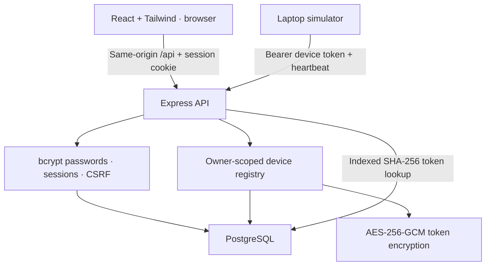

# Open IoT — Milestone 1

A complete, self-hosted **landing page, authentication system, and device management console** built with React + Tailwind CSS, Node.js/Express, and PostgreSQL. Includes a working laptop simulator: **no ESP32 or other board is required**.

This is a separate, focused milestone package. It uses a fresh `openiot_m1` database and is not a drop-in SQL migration over the earlier MQTT prototype. The earlier starter is preserved. MQTT commands, virtual-pin widgets and Google/Alexa are not implemented in Milestone 1.

## What you can do

- Visit a responsive landing page with Get Started, Login, Features, and quick-start documentation.
- Register, log in, log out, and access protected dashboard routes.
- View your profile, update your name, change your password, sign out all sessions, or delete your account.
- Create ESP32, ESP8266, Raspberry Pi, simulator, or other device records.
- Generate a unique device auth token automatically.
- View a paginated registry with token previews, online/offline/disabled status, and last-seen times.
- Reveal or rotate a token after confirming your account password.
- Rename, disable/enable, or delete your own devices.
- Download a simulator config and send authenticated heartbeats from your laptop.

The landing-page preview is explicitly illustrative. The actual workspace starts empty; status comes from real authenticated API requests, not seeded display data.

## 1. Architecture



Development: React runs at `http://localhost:5173`; Vite proxies `/api` to Express on port 3000. The browser therefore sees one origin. Production: Express can serve the compiled frontend and API together behind HTTPS. No broad CORS policy is needed.

Authentication uses an **opaque session cookie**, one of the user-requested alternatives to JWT. Its random identifier is hashed in PostgreSQL and never stored in localStorage. Device tokens are separate credentials and cannot log a user into the website.

## 2. Quick start — Windows PowerShell

Requirements:

- Node.js **22.12+ or 24 LTS**. Upgrade if your terminal still reports Node 20.
- Docker Desktop running, with Linux containers.
- No microcontroller or physical device.

Extract the ZIP and open PowerShell in `open-iot-milestone-1`:

```powershell
node --version
docker version
npm ci
npm run setup
docker compose up -d postgres
npm run migrate
npm run dev
```

Open **http://localhost:5173**. Use **Create account** to register your own user. There are no default credentials.

`npm run setup` creates `.env` with a random PostgreSQL password and a random encryption key. It will never overwrite an existing `.env`. Keep this file private. Docker's first startup may need a few seconds before migration can connect; if PostgreSQL is still starting, wait for `docker compose ps` to show it healthy, then retry `npm run migrate`.

If another PostgreSQL instance already uses port 5432, change the host side of the mapping in `compose.yaml`, then update `DATABASE_URL` in `.env` to the same host port. If Vite port 5173 is occupied, stop the other instance or update both Vite's port and `APP_ORIGIN`; they must match exactly.

### All application services in Docker

After `npm run setup`:

```powershell
docker compose --profile app up --build
```

Open **http://localhost:3000**. This profile builds React, waits for PostgreSQL, migrates, and runs Express. It is an intentional **local HTTP configuration**, bound to loopback. Do not also start `npm run dev` on the same ports. Use the simulator on your host with Node, or run it in a separate configured environment.

The Docker profile has not been runtime-tested in the authoring environment; Node, database-engine, and browser tests are recorded in `docs/VALIDATION.md`.

### Existing local PostgreSQL, no Docker

Create an empty database named `openiot_m1`, configure `DATABASE_URL` in `.env`, then run:

```powershell
npm run migrate
npm run dev
```

The runtime uses PostgreSQL through `pg`, not SQLite or browser storage. PGlite is used exclusively by automated/visual tests.

## 3. Connect your first simulated device

1. Create an account and open **Devices**.
2. Choose **Add device**.
3. Name it `My laptop simulator` and leave the type as **Laptop simulator**.
4. Click **Create device**. A secure random token is generated.
5. Click **Simulator config**, saving `.device.env` in the project root (beside `package.json`). Ensure Windows has not appended `.txt`.
6. Open a second terminal in the same folder:

```powershell
npm run simulate
```

The simulator sends a heartbeat every 10 seconds. The dashboard refreshes every 5 seconds. Press Ctrl+C to stop the simulator; after 30 seconds without a heartbeat, the device becomes offline, visible on the next poll.

Manual config alternative:

```powershell
Copy-Item .device.env.example .device.env
```

Edit:

```dotenv
API_URL=http://localhost:3000
DEVICE_TOKEN=PASTE_THE_TOKEN_FROM_YOUR_DEVICE
```

After token rotation, update this file and restart the simulator. A disabled, deleted, or rotated token receives HTTP 401. Simulator credentials are not printed in its logs. The simulator only allows plaintext HTTP to localhost; use HTTPS for remote hosts.

## 4. Project structure

```text
server/
  index.js              PostgreSQL pool, server startup, cleanup and shutdown
  app.js                Session auth, account routes, device routes, heartbeat
  security.js           bcrypt input rules, random tokens, hashes, AES-GCM
sql/
  001-initial.sql        Complete users, sessions, devices, audit DDL
scripts/
  setup.js              Generate private local environment configuration
  migrate.js            Versioned, checksummed, transactional SQL migrations
  simulator.js          Continuous authenticated laptop heartbeat client
web/
  src/
    Landing.jsx         Landing page and product preview
    AuthPages.jsx       Registration and login
    auth.jsx            Auth provider and protected routes
    Dashboard.jsx       Device registry, forms, token dialogs
    Account.jsx         Profile, password and account management
    Docs.jsx            In-app quick start
    api.js              Same-origin API helper and in-memory CSRF token
    ui.jsx              Shared components and accessible native dialogs
    main.jsx            Route definitions
    style.css           Tailwind import/theme plus custom styling
  public/favicon.svg
  vite.config.js        React/Tailwind plugins and local API proxy
compose.yaml
Dockerfile
tests/                  API/security tests and self-contained browser check
```

One `npm ci` at the repository root installs the workspaces from the included lockfile.

## 5. Schema design

The full, executable SQL is in `sql/001-initial.sql`.

| Table | Purpose | Important constraints/indexes |
|---|---|---|
| `users` | Name, normalized email, bcrypt hash, timestamps | UUID PK, unique indexed lowercase email |
| `sessions` | Hashed session ID, user, CSRF secret, absolute expiry | Hash PK, user FK with cascade, expiry index |
| `devices` | Owner, name/type, token material, last heartbeat, disable state | UUID PK, owner FK with cascade, unique token digest index, owner/date index |
| `audit_events` | Device credential access/change and selected account events | User/time index; no raw passwords or tokens |

The `UNIQUE(token_hash)` constraint creates a PostgreSQL B-tree index, supporting fast credential lookup. Tokens contain 32 cryptographically random bytes encoded as 43 base64url characters. Device status is derived at query time:

```sql
CASE
  WHEN disabled_at IS NOT NULL THEN 'disabled'
  WHEN last_seen_at > now() - interval '30 seconds' THEN 'online'
  ELSE 'offline'
END
```

This indicates **recent authenticated contact**, not guaranteed physical reachability at every instant. Device registration alone never marks a device online. Disable/enable and token rotation reset freshness, requiring another heartbeat.

All queries using device IDs also require `user_id` from the authenticated session. The API never accepts ownership from a posted `userId`. Device listing is paginated at 20 rows, with a 1,000-device account cap in this milestone.

Migrations are checksummed and serialized with a PostgreSQL advisory lock. The `schema_migrations` bookkeeping table is created by the migration runner. Do not edit an applied migration; add a new SQL file. Do not run this initial schema over the earlier prototype database.

## 6. Authentication and authorization

### Registration

`POST /api/auth/register` validates the body, normalizes email, hashes the password using bcrypt (via bcryptjs, cost 12), inserts a user, creates a session, and returns a safe profile. Unique database constraints prevent duplicate emails under concurrent requests.

```json
{"name":"Nithin","email":"you@example.com","password":"a-long-unique-password"}
```

Passwords must have at least 12 characters and at most 72 UTF-8 bytes. The byte limit is enforced explicitly because bcrypt otherwise truncates long inputs. Passwords are not trimmed or normalized.

### Login

`POST /api/auth/login` compares the bcrypt hash and returns a fresh random session. Invalid email and invalid password share the same generic error. A dummy bcrypt comparison is performed for nonexistent users. Login is rate-limited. A database lock prevents an in-progress login with an old password from issuing a session after password rotation.

### Cookies and CSRF

- Seven-day absolute session lifetime, stored server-side.
- Cookie: `HttpOnly`, `SameSite=Lax`, `Path=/`.
- Production: `Secure` and `__Host-openiot_session` name, no Domain attribute.
- Session ID is hashed in PostgreSQL. It is not a JWT and needs no signing key.
- A per-session CSRF token is returned by login/registration/`GET /api/auth/me` and kept in memory by React.
- Authenticated mutations require `X-CSRF-Token` plus the exact configured `Origin` and JSON content type.
- Registration/login require exact Origin and JSON content type to prevent cross-origin browser submissions.
- Heartbeat is a distinct bearer-token endpoint and never uses browser session credentials.
- Logout deletes the current session. Logout-all deletes all user sessions. Password change revokes all sessions and issues a replacement for the current browser.

The frontend route guard improves navigation, but the backend enforces every authorization decision. A user cannot bypass it by visiting `/dashboard` directly or editing the browser UI.

### Account management

Profile editing covers the display name. Email is read-only because an email-change flow should verify the new address. Password change and account deletion require the current password. Account deletion cascades devices and sessions. Minimal audit events remain with a null user ID; define retention/anonymization requirements before broader deployment.

Forgot-password email, email verification, MFA, OAuth login, organization membership, and admin roles are not part of this milestone. The UI does not pretend those features exist.

## 7. Device token storage and lifecycle

This implementation supports the requested ability to **copy an existing assigned token later**. A hash alone cannot recover it, so the server stores both:

1. `token_hash`: SHA-256 digest for indexed authentication.
2. AES-256-GCM ciphertext, a random 12-byte IV, and a 16-byte authentication tag for authorized recovery.

The device UUID is authenticated additional data, preventing ciphertext from being moved to another device row unnoticed. The encryption key is a separate 32-byte backend environment secret; it is never in the database or frontend bundle.

Creation returns the full token over the authenticated response. Lists return only a masked preview. To reveal or rotate it, the user supplies their current password again; ownership and the session are rechecked inside the transaction. Reveal/rotation events are audited. The token dialog clears after 60 seconds. Copying/download is explicit, and the downloaded config is excluded from version control.

Rotation atomically replaces the hash and encrypted credential, increments its version, and immediately invalidates the old token. There is one active token per device in this milestone. Disable preserves the token but blocks authentication; deletion revokes it permanently.

**Encryption-key operations:** preserve and back up `TOKEN_ENCRYPTION_KEY` separately from the database. Losing it prevents token recovery, though existing token hashes can still authenticate. Changing the key without re-encryption breaks reveals of existing tokens. For a planned key rotation, build a versioned key ring and transactional re-encryption migration; do not simply replace the environment variable on a live instance. A server compromise that exposes both the database and key can recover credentials. A one-time-display/hash-only design can be used instead if later token recovery is unnecessary.

## 8. API reference

All responses are JSON. API responses use `Cache-Control: no-store`. Errors use `{ "error": "message" }`.

| Method | Route | Authorization and purpose |
|---|---|---|
| GET | `/api/health` | Database readiness |
| POST | `/api/auth/register` | Origin check, rate limit; create account/session |
| POST | `/api/auth/login` | Origin check, rate limit; create session |
| GET | `/api/auth/me` | Session; profile and CSRF token |
| POST | `/api/auth/logout` | Session + CSRF; current session |
| POST | `/api/auth/logout-all` | Session + CSRF; all user sessions |
| PATCH | `/api/account` | Session + CSRF; display name |
| PUT | `/api/account/password` | Session + CSRF + password; replace password |
| DELETE | `/api/account` | Session + CSRF + password; delete account |
| GET | `/api/devices?page=1` | Session; owner-scoped registry and totals |
| POST | `/api/devices` | Session + CSRF; create device and token |
| PATCH | `/api/devices/:id` | Session + CSRF; rename or disable/enable |
| DELETE | `/api/devices/:id` | Session + CSRF; delete owned device |
| POST | `/api/devices/:id/token/reveal` | Session + CSRF + password; recover token |
| POST | `/api/devices/:id/token/rotate` | Session + CSRF + password; replace token |
| POST | `/api/device/heartbeat` | Device bearer token; update last-seen |

Create-device body:

```json
{"name":"My laptop simulator","deviceType":"simulator"}
```

Heartbeat request:

```http
POST /api/device/heartbeat
Authorization: Bearer DEVICE_AUTH_TOKEN
Content-Type: application/json

{}
```

Heartbeat response:

```json
{"deviceId":"device-uuid","status":"online","lastSeenAt":"2026-10-09T10:00:00.000Z"}
```

Browser requests use `fetch('/api/...', { credentials: 'include' })`. Mutations add `X-CSRF-Token`; `api.js` handles this centrally. Avoid putting session IDs or device secrets in query strings, localStorage, analytics, or URLs.

## 9. Tests

```powershell
npm test
npm run build
npm audit
```

Tests run against a real PostgreSQL engine through PGlite/WASM and do not require Docker. They verify registration/login, ownership, CSRF/origin checks, bcrypt input limits, authenticated token encryption, reveal/rotation, heartbeat freshness, disable/re-enable, session invalidation, and account deletion. Test bcrypt cost is lowered to 4 solely for test runtime; the normal server uses 12.

Browser QA (after building):

```powershell
npx playwright install chromium
node tests/browser-check.mjs
```

The browser check starts its own server on port 4178 with an **ephemeral test database**, relaxed test rate limits and a temporary encryption key, then shuts it down. This is never used by the delivered runtime. It uses a disposable demo account and does not contact user hardware.

## 10. Production deployment notes

- Build React (`npm run build`), then run the regular Express server behind a trusted HTTPS reverse proxy. Set `NODE_ENV=production` and the exact HTTPS `APP_ORIGIN`.
- Bind the backend privately. Set `TRUST_PROXY` only for your actual trusted proxy network (e.g. `loopback` for a same-host proxy), never blindly to `true`.
- Use a dedicated runtime PostgreSQL role with only required table privileges and a separate migration role. The local Docker database owner is a development convenience.
- Keep database credentials, token-encryption keys, and simulator configs out of version control. Use a secret manager for a shared deployment.
- Back up PostgreSQL and encryption keys; test restoration. Add audit retention, monitoring, error reporting with redaction, and operational alerts.
- Rate limits here are process-local and IP-based. Before horizontally scaling, add a shared store and per-account abuse controls. Calibrate bcrypt cost under expected concurrency; rate limiting is not complete DDoS protection.
- Add verified email/password recovery, MFA, and a security review before opening a public multi-user service. Public registration is enabled in this implementation.
- Use HTTPS for real remote devices. For later MQTT, connect broker authentication to the same indexed token digest and owner/device mapping, with exact per-device topic ACLs. The M1 heartbeat endpoint is not an MQTT broker.

## 11. Primary references

- bcrypt.js behavior and 72-byte input limit: https://github.com/dcodeIO/bcrypt.js
- Node.js random bytes, hashing and authenticated encryption: https://nodejs.org/api/crypto.html
- Tailwind/Vite integration: https://tailwindcss.com/docs/installation/using-vite
- Express production security practices: https://expressjs.com/en/advanced/best-practice-security.html

MIT licensed. This implementation is tested boilerplate for the requested milestone, not a claim of independent security certification.
